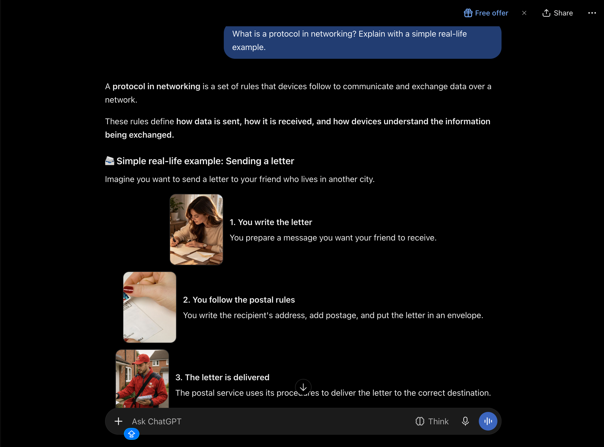
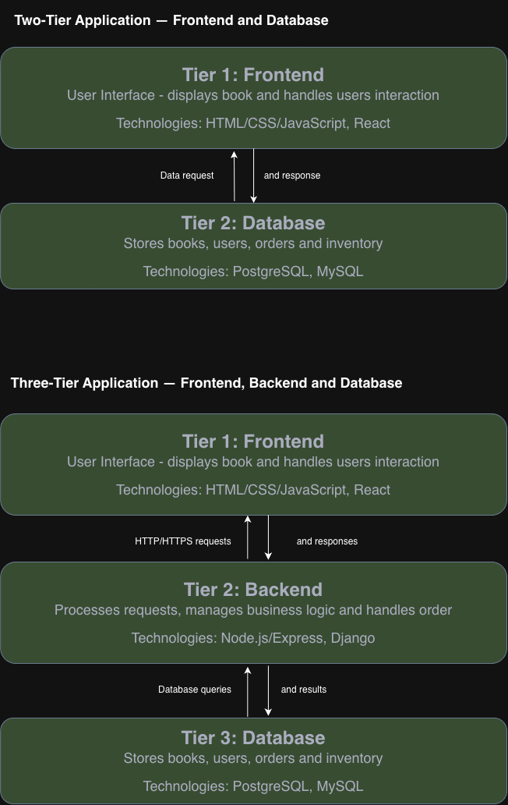
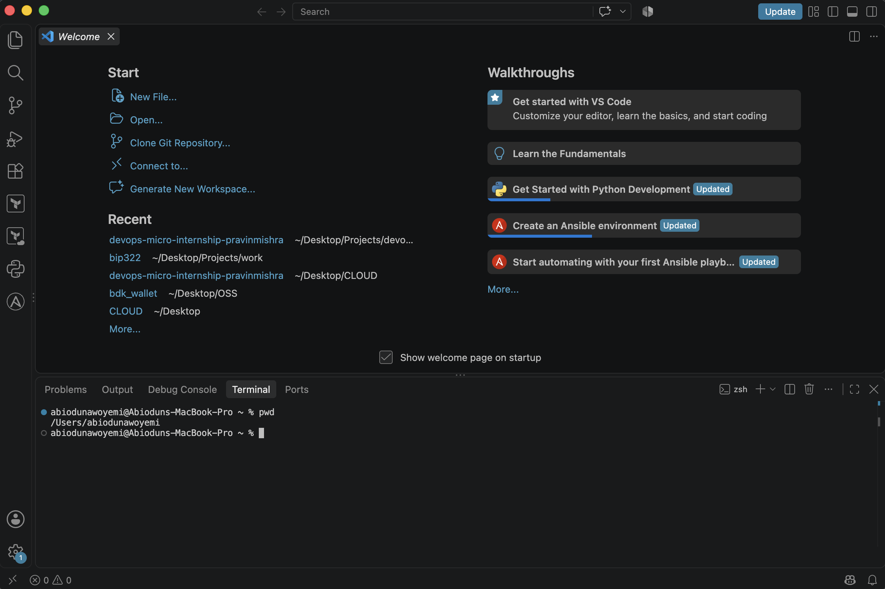

# Week 00 - Internet and Networking

Part of the DevOps Micro Internship (DMI) with Agentic AI

---

# 🧑‍💻 Task 1: Using ChatGPT as Your Learning Assistant

## Scenario

You're new to DevOps and will frequently encounter technical questions. ChatGPT can be your learning companion.

## Your Task

Write a clear ChatGPT prompt to help you understand:

> "What is a protocol in networking? Explain with a simple real-life example."

Take a screenshot of your interaction showing:

* Your detailed prompt (with clear expectations)
* ChatGPT's simplified response with an example

## Screenshot

Save your screenshot in the `screenshots` folder and update the file name below.




Replace `task-1-chatgpt.png` with your actual screenshot file name.

---

## What I Learned (2–3 lines)

A networking protocol is a set of rules that allows computers and devices to communicate and exchange data. Like postal rules for sending letters, protocols ensure data reaches the correct destination in the right format. Packets are small units of data into which information is divided for transmission across a network and then reassembled at the destination.

---

# 🌐 Task 2: Internet and Networking

## Scenario

Your friend is launching an online bookstore named **EpicReads**.

He asked you to explain how users globally can access his website hosted in Finland.

## Your Task

Write a short explanation (**100–150 words**) that includes:

* Packet Switching
* IP Address
* TCP/IP
* HTTP/HTTPS

💡 **Tip:** You may use ChatGPT (as demonstrated in Task 1) to refine your explanation.

## Answer
**EpicReads** is an online bookstore hosted on a server in Finland, accessible to users worldwide through the internet. When users access the website, **packet switching** divides their data into small packets that travel across different networks and are reassembled at the destination. Each device and server uses an **IP address** to identify destinations and route data to the correct location. **TCP/IP** enables communication between devices, with TCP ensuring reliable, ordered data delivery and IP handling addressing and routing. Finally, **HTTP/HTTPS** allows browsers to request webpages from EpicReads' server, while HTTPS encrypts communication to protect sensitive information, such as login credentials and payment details. Together, these technologies enable users worldwide to browse books and shop securely on EpicReads.

---

# 🏗️ Task 3: Application Architecture & Stack

## Scenario

EpicReads bookstore has two application versions:

### Two-Tier Application

* Frontend
* Database

### Three-Tier Application

* Frontend
* Backend
* Database

## Your Task

* Draw simple diagrams (hand-drawn or tool-based such as draw.io)
* Label each layer clearly
* List at least two common technologies or tools used for each layer
* Submit a screenshot or photo clearly showing your own drawing

## Diagram Screenshot / Photo

Save your diagram image in the `screenshots` folder and update the file name below.



---

## Technologies Used

### Frontend

* HTML/CSS/JavaScript
* React

### Backend

* Node.js/Express
* Django

### Database

* PostgreSQL
* MySQL

---

# 🌍 Task 4: Domain Name & DNS (Basic Concepts)

## Scenario

Your friend's bookstore **EpicReads** is currently accessible through:

```text
52.172.142.222:3000
```

He purchased the domain:

```text
epicreads.com
```

## Your Task

In **50–100 words**, explain in your own words:

1. What is DNS (Domain Name System)?
2. Which DNS record type should be used to connect the domain to the given IP, and why?

## Answer

DNS (Domain Name System) is a system that translates human-readable domain names into IP addresses, allowing users to access websites without memorising numerical addresses. For EpicReads, an A record maps `epicreads.com` to the IPv4 address `52.172.142.222`. Since the website runs on port `3000`, a reverse proxy may be needed to enable access through standard HTTP/HTTPS ports.

---

# 💻 Task 5: Visual Studio Code Setup (Hands-on)

## Your Task

Install Visual Studio Code (if not already installed).

Take a screenshot of your VS Code environment showing:

* Terminal open inside VS Code
* Running a basic command:

### Windows

```powershell
dir
```

### Linux / macOS

```bash
pwd
ls
```

* Your selected VS Code theme clearly visible

⚠️ **Important:** The screenshot must show your username or another identifiable detail to confirm it is your environment.

## Screenshot

Save your screenshot in the `screenshots` folder and update the file name below.



---

# 🔗 Task 6: Publish Your Assignment as a LinkedIn Post

## Objective

Publishing on LinkedIn helps you:

* Build your professional online presence
* Reinforce your learning
* Document your DevOps journey publicly

## Your Task

Summarize your answers from Tasks 1–5 into a LinkedIn post.

Clearly structure your post into the following sections:

* ChatGPT
* Internet & Networking
* App Architecture
* DNS
* VS Code Setup

Use the credit note that matches your track:

Add the following credit note at the end of your post **(If you are DMI Cohort 3 student)**:

> **P.S. This post is part of the DevOps Micro Internship (DMI) with Agentic AI — Cohort 3 — by Pravin Mishra. My graded progress is public: https://dmi.pravinmishra.com/s/YOUR-GITHUB-USERNAME.html · Start your DevOps journey: https://dmi.pravinmishra.com/?utm_source=student&utm_medium=ps-linkedin&utm_campaign=cohort3**

**Tag [Pravin Mishra](https://www.linkedin.com/in/pravin-mishra-aws-trainer/) in your LinkedIn post, then tag Lead Co-Mentor — [Anjana Muthunayake](https://www.linkedin.com/in/anjana-muthunayake/).**

Add the following credit note at the end of your post **(If you are DMI Self-paced track student)**:

> **P.S. This post is part of the DevOps Micro Internship (DMI) — Self-Paced Engineer Track — by Pravin Mishra. My graded progress is public: https://dmi.pravinmishra.com/s/YOUR-GITHUB-USERNAME.html · Start your DevOps journey: https://dmi.pravinmishra.com/?utm_source=student&utm_medium=ps-linkedin&utm_campaign=self-paced**

Add the following credit note at the end of your post **(If you are DMI Campus student)**:

> **P.S. This post is part of the DevOps Micro Internship (DMI) — Campus — by Pravin Mishra. My graded progress is public: https://dmi.pravinmishra.com/s/YOUR-GITHUB-USERNAME.html · Start your DevOps journey: https://dmi.pravinmishra.com/?utm_source=student&utm_medium=ps-linkedin&utm_campaign=campus**

**Tag [Pravin Mishra](https://www.linkedin.com/in/pravin-mishra-aws-trainer/) in your LinkedIn post, then tag Lead Co-Mentor — [Anjana Muthunayake](https://www.linkedin.com/in/anjana-muthunayake/).**

Hashtags:

#DMIByPravinMishra #AgenticAI #DevOps

Replace `YOUR-GITHUB-USERNAME` with your GitHub username — that link is your public DMI progress page (your graded badge page).
---

## LinkedIn Post URL

Paste your LinkedIn post URL here:

```text
My LinkedIn is currently under suspension, I have tried to do reverification, but will take 48 hours to 5 working days
I will update with the link immediately my account is rectified.
```

---

## LinkedIn Post Backup Copy

Paste the full text of your LinkedIn post here:

My DevOps Journey Begins: Week 00 — Internet and Networking

As part of the DevOps Micro Internship (DMI) with Agentic AI, I’ve been building my foundational knowledge of the internet, networking, and application architecture. Here are my key takeaways from Week 00! 

1. ChatGPT: I explored how ChatGPT can serve as a learning assistant by explaining technical concepts in simple terms. I learned that a networking protocol is a set of rules that enables devices to communicate and exchange data.

2. Internet and Networking: I learned how users worldwide can access EpicReads, an online bookstore hosted in Finland. Key concepts include packet switching, IP addresses, TCP/IP, and HTTP/HTTPS.

3. App Architecture: I explored two-tier and three-tier application architectures. A two-tier application connects the frontend directly to the database, while a three-tier application introduces a backend layer to handle business logic between the frontend and database. 
Technologies explored:
Frontend: HTML, CSS, JavaScript, React
Backend: Node.js/Express, Django
Database: PostgreSQL, MySQL

4. DNS (Domain Name System): I learned how DNS translates human-readable domain names into IP addresses. For EpicReads, an A record maps epicreads.com to the IPv4 address 52.172.142.222.

5. VS Code Setup: I worked on setting up my development environment using Visual Studio Code, including using its integrated terminal to execute basic commands and navigate directories.

Key takeaway: Building a strong understanding of networking, DNS, and application architecture is an important step toward becoming a capable DevOps engineer. I’m excited to keep learning, practising, and building!

P.S. This post is part of the DevOps Micro Internship (DMI) with Agentic AI — Cohort 4 — by Pravin Mishra. My graded progress is public: https://dmi.pravinmishra.com/s/devabiodun.html. Start your DevOps journey: https://dmi.pravinmishra.com/?utm_source=studentamp;utm_medium=ps-linkedinamp;utm_campaign=cohort4

#DMIByPravinMishra #AgenticAI #DevOps

---

# Reflection – Week 0

### What did you find easy?
I found it easy to understand basic networking concepts, such as protocols, IP addresses, and DNS, especially with the help of ChatGPT and real-life examples.

---

### What was difficult?
I was unable to understand all the concept easily, so there is nothing difficult yet.

---

### What will you improve next week?
I will improve my practical DevOps skills by practising more with the terminal, exploring networking commands, and learning how to configure and deploy applications.

---

## 📌 About DMI & CloudAdvisory

DevOps Micro Internship (DMI) is a project-based DevOps program run by Pravin Mishra (The CloudAdvisory) focused on real-world execution, systems thinking, and career readiness.

It helps learners build strong DevOps foundations with hands-on experience.


## 📌 Resources

- 🌐 **DMI Official Website:** https://dmi.pravinmishra.com?utm_source=github&utm_medium=readme  
- 🎓 **University:** https://university.pravinmishra.com?utm_source=github&utm_medium=readme  
- 💬 **Discord Community:** https://discord.pravinmishra.com?utm_source=github&utm_medium=readme  
- 📝 **Blog:** https://dmi.pravinmishra.com/blog?utm_source=github&utm_medium=readme  
- ▶️ **YouTube Playlist (DMI Cohort 3):** https://www.youtube.com/playlist?list=PLFeSNDtI4Cho  
- 🔗 **Pravin Mishra (LinkedIn):** https://www.linkedin.com/in/pravin-mishra-aws-trainer/  
- 🏢 **CloudAdvisory (LinkedIn):** https://www.linkedin.com/company/thecloudadvisory/

---

*This submission is part of DevOps Micro Internship (DMI) — Agentic AI Track*